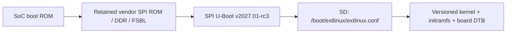

# Modern SPI U-Boot and retained vendor firmware

The latest profile-aware candidate serves the [common Server/Media
image](MODES.md). It validates reserved-memory nodes from the OS device tree,
requires inactive ACPU/RPC before either boot, and arms Media's secure startup
flag at EL3 without launching firmware. Linux loads the firmware from SD.
The `bananapi,spi-media-handoff = "v1"` marker identifies a compatible running
loader. The [common-mode SPI update](hardware/spi-modes-flash-2026-11-27.md)
passed full-chip readback and a Server cold boot with four CPUs and 1.9 GiB
RAM; Linux confirmed the marker. Media startup/output still needs separate
hardware validation. The [UART update guide](SPI-UPDATE.md) describes the saved
full-chip backup, flashing checks and restoration. The local SPI RPM contains
firmware files; an OS flash driver/updater remains to be developed.

The target is one modern U-Boot in SPI, retaining the vendor DDR/FSBL firmware,
loading versioned kernels from SD. Fedora RPM repositories supply userspace;
a maintained board kernel would be distributed through COPR. Official Fedora
IoT images are no longer a requirement. The working server image is retained as
the [hardware smoke-test baseline](hardware/server-2026-11-26.md).

Stages 1–4 are approved: preserve the server baseline, investigate the unchanged
vendor build, develop a modern SPI loader and integrate versioned kernel updates.
Stage 3 produces a
host-validated **v2027.01-rc3** candidate using current Fedora compilers and
OpenSSL. Stage 4 adds [kernel update RPMs and an SD test image](KERNEL-UPDATES.md).
COPR publishing remains separate. The user has now explicitly approved the
first SPI write and accepted the unverified recovery risk.

## Build the modern candidate

```sh
make spi SPI_DRAM_GIB=2 JOBS=8
# Source preparation alone, when needed:
make srpm-spi SPI_DRAM_GIB=2
```

The native Bash preparation script archives pinned Git objects, excluding the
vendor SDK toolchains. `rpkg srpm` creates a self-contained source package;
`/usr/bin/mock --rebuild` compiles it as the regular user. The SPEC checks source
hashes, configuration, AArch64 entry address, payload limits and vendor-reference
comparisons. No custom Python script prepares or packages this SPI build;
upstream U-Boot still uses Python build tools. No legacy compiler or obsolete
OpenSSL library is needed. Select `SPI_DRAM_GIB=1` only for a 1 GiB board; the
recorded build and preserved hardware baseline use 2 GiB.

| Product | Location / meaning |
| --- | --- |
| Self-contained SRPM | `out/srpms/spi.src.rpm` and SHA256 sidecar |
| Local candidate RPM | `out/spi/bpi-m4-spi.rpm` and SHA256 sidecar; installation does not flash anything |
| Modern loader | `out/spi/u-boot.bin`, AArch64 ELF `u-boot`, and `uboot.config` |
| Raw primary boot region | `out/spi/spi-boot-region.bin`; **not a complete SPI-chip image** |
| Integrity and layout | `out/spi/SHA256SUMS`, `spi-layout.json`, `spi-sources.sha256` |
| Audit and tool versions | `out/spi/build-audit.json`, `installed_pkgs.log` |
| Full Mock logs | `work/rpms/spi/result/` |

`make spi` also runs as part of the common `make image` workflow and reuses
products while its declared inputs remain unchanged. The legacy `make rpms`
targets retain their separate SD-loader path. `make srpm-spi` replaces the SRPM
alias without rebuilding the binary candidate. After a new
`make spi`, verify the published artifacts with:

```sh
(cd out/srpms && sha256sum --check spi.src.rpm.sha256)
(cd out/spi && sha256sum --check bpi-m4-spi.rpm.sha256 SHA256SUMS)
```

### Source identities and build evidence

| Input | Pinned identity |
| --- | --- |
| Official U-Boot release candidate | `v2027.01-rc3`, commit `ee1b3477e3af6af1ae9b8f98bc84d2cc6f32a3a6` |
| Prepared U-Boot Git archive SHA256 | `b3863b989acae8f305ab3d0abc9287205991288ca1eff0e26a7c4db01e1dd6bc` |
| Vendor BSP | `25f5b88ec4ba34029f964693dc34028b26e6c67c` |
| Prepared vendor archive SHA256 | `32e34dddd81ae4107d707109519957a3c27b3d5552d90dd0a26da78dc1073e93` |

The U-Boot archive comes from the pinned official Git commit rather than the
Fedora SRPM used by the existing SD loader. The Git commit and archive checksums
provide source identity and local integrity; this route does not claim detached
release-signature verification or signed build attestation.

The 2026-11-26 2 GiB build used host GCC 16.2.1-3.fc45, AArch64 GCC
16.2.1-1.fc45 and OpenSSL 4.0.3-1.fc45. It produced a 304,392-byte loader with
entry `0x00100000` and a 537,424-byte raw boot region. The retained FSBL hash
matches the table below. `make test` passed 43 checks in Mock, including actual
C-code fault harnesses for cold SD initialization and generic partition boot.
The SPI build additionally passed 12 SHA/padding, 8 obfuscation and 3 RSA
reference comparisons, DDR-generation comparisons, header comparison and a
byte-for-byte comparison of the complete region with the rebuilt vendor packer.

These build checks establish compilation and packaging compatibility. The
subsequent [RAM test](hardware/spi-ram-test.md) reached Linux, mounted the generic
SD root, verified the boot bundle and obtained wired networking. CPUs 1–3 failed
to start. SPI was unchanged during that RAM test. The subsequent
[physical SPI write and cold boot](hardware/spi-flash-2026-11-26.md) passed
full-chip readback and booted Fedora through a single modern U-Boot. FSBL
acceptance, generic SD root, boot-bundle integrity and wired networking were
verified on this 2 GiB board. That installed loader had one CPU. The later
[CPU investigation](hardware/spi-cpu-2026-11-26.md) established the FSBL's
separate secondary entry and tested the complete fixed loader in RAM with all
four CPUs. A 256 MiB bounded memory/coherency test passed with the existing
kernel. The new loader is 304,776 bytes, with a 537,808-byte raw region;
the prior sizes above describe the earlier physically programmed loader.
SPI was unchanged during that RAM investigation. The subsequent
[CPU-fix SPI update](hardware/spi-cpu-flash-2026-11-26.md) passed full-chip
readback, three physical cold boots and three Linux watchdog reboots with all
four CPUs. The same memory/coherency and networking checks passed on every
cycle. Real kernel installation, fallback, unused-version removal and
reinstallation also passed. eMMC initialization remains unfinished.

## Intended boot flow and SD contract



The new SPI loader replaces the 2015 U-Boot and goes directly to Linux;
retained early firmware still initializes DDR. It does not chainload another
U-Boot from SD. Existing SD images retain their old SPI prerequisite and
v2026.10 second-stage loader. Stage 4 produces a separate SPI test image;
the SPI server image now has a successful physical cold boot on the tested
2 GiB board, with the limitations recorded above.

`src/spi/` holds the SPI board configuration, entry setup, cold SD initialization,
generic boot command and native host packaging primitives. It shares the
retained SD controller and secondary-core handoff in `src/u-boot/`; the SPI
initialization hook is conditional and leaves the existing SD target's behavior
unchanged. ACTLR and EL3 GIC setup follow the RTD1395 vendor entry sequence.
The loader keeps the existing uncached SD protocol and does not enable U-Boot
SD writes or persistent environment writes.

The retained FSBL starts CPU0 at `0x100000` and secondary CPUs at `0x30000`.
Immediately before releasing CPUs 1–3, the SPI loader copies and verifies the
112-byte loop in `src/spi/secondary.S` at the latter address, below Linux's RAM
bank. It waits on the existing 32-bit mailbox at `0x98007f30`; the existing
kernel entry shim handles EL3-to-EL2 startup. This avoids depending on the main
U-Boot image for secondary entry once Linux starts. The legacy SD target keeps
its existing handoff. See the CPU report for disassembly and the subsequent
SPI update report for persistent boot evidence.

At boot, `bpispiboot` checks that ACPU/RPC is inactive, initializes SD controller
0, and scans MBR/GPT partitions 1–16 for `/boot/extlinux/extlinux.conf`. It checks
partition bounds against the detected SDHC/SDXC card, then provides:

- `${bpi_root}`: `PARTUUID=...` for the partition containing the configuration.
- `${bpi_sd_args}`: detected CID, card read capacity, bounded root write range
  and the activation arguments required by the current board SD/Ethernet drivers.

Use an **ext4 root containing `/boot`**, with no separate boot filesystem, for
the supplied example. The root must be the configuration partition because the
current kernel's write permission covers only that partition. No card UUID,
kernel hash or kernel version is embedded in SPI. The loader also passes a
CID-derived local Ethernet MAC and corrects the kernel DTB's installed RAM size.
It requires a full compatible BPI-M4 kernel DTB, rejecting its own minimal UART
control DTB. Kernel/initramfs load addresses are above retained firmware pools
and fit both supported RAM sizes.

See [`packaging/files/extlinux.conf.example`](../packaging/files/extlinux.conf.example).
Replace `VERSION` with an installed board-kernel release and keep older labels
for manual fallback. The example uses uncompressed AArch64 Linux Image files,
matching initramfs files and board DTBs in versioned `/boot/bpi-m4/` bundles.
It uses `rdinit=/init` for the generic project initramfs.

The separate `bpi-m4-kernel` update variant owns versioned sources under `/usr/lib`
and activates `/boot/bpi-m4/RELEASE/` through `bpi-m4-bootctl` after installation.
Its generic initramfs discovers the SD root without an image-specific layout.
See [KERNEL-UPDATES.md](KERNEL-UPDATES.md) for packaging and fallback controls.
The legacy server/media RPMs retain their existing staged SD payloads.
The menu does not yet provide automatic failed-boot detection or rollback.
The SD configuration and payloads are trusted local inputs; this candidate does
not implement signature-enforced kernel boot. The current server memory contract
requires inactive ACPU/RPC. Physical cold boots and Linux watchdog reboots passed
under that contract. Media firmware startup is not qualified, and U-Boot's
`reset` command currently requests a physical power cycle. Full firmware
boot/reset timing remains unmeasured.

The CPU fix removes the approximately 15-second kernel timeout in the tested
RAM boot. During the six subsequent SPI boot cycles, `systemd-analyze` measured
1.646–1.663 seconds kernel startup; these measurements exclude firmware time.
Complete power-on timings have not been measured. Three complete Linux watchdog
restarts passed with inactive ACPU/RPC, while U-Boot's own reset command and
media reset remain as described above. Keep supply connections stable during
qualification; the shared charger was changed during earlier unexpected resets.

## Native packaging and retained firmware

`scripts/pack-spi.bash` rebuilds the vendor DDR-setting generator with current
GCC. `src/spi/spi-tools.c` uses current OpenSSL EVP/BN APIs for SHA padding,
mode-97 AES obfuscation and the RTD1395 RSA trailer. `spi-layout.c` bounds and
assembles the raw boot region. No 2015 U-Boot object or vendor updater executable
is included in the candidate.

Reference checks rebuild the vendor SHA helper and packer with current GCC;
they also run the pinned native-host DDR generator and `obfuse_h` for byte
comparisons. Those two reference executables need current glibc, not an old
toolchain/runtime, and do not generate the shipped candidate. The vendor Perl
RSA formatter is used only as an independent reference, with current OpenSSL
`pkeyutl` and bigint packages. The obsolete RtSSL binary is never loaded.

The format deliberately retains vendor conventions:

- ROM slot: 188 KiB; MIPS slot: 4 KiB; zero parameter slot: 2 KiB.
- Header begins at `0x30800` and is 64 bytes plus SHA256, obfuscated to 96 bytes.
- Hardware settings carry a 520-byte RSA record: reversed signature and
  little-endian `2^4352 mod N`, followed by the **big-endian** 64-bit inverse.
- With `Config_Secure_Improve` false, U-Boot is plaintext with vendor SHA padding
  and a SHA256 trailer. The active vendor recipe still passes `boot_enc`, so its
  header subtracts 520 bytes from the U-Boot component length. The candidate
  preserves this unusual convention and matches the reference packer. The
  [installed-header audit](hardware/spi-backup-2026-11-26.md) verifies that its
  U-Boot size plus 520 equals the cold-boot FSBL UART load size, and that the
  installed FSBL/DDR bytes match the candidate. The subsequent physical cold
  boot confirmed the new header's 304,480-byte U-Boot component load and
  reached the modern U-Boot banner. This applies to the board-specific full
  candidate, which preserves the installed ROM slots and parameter area.
- The raw region is bounded below the factory offset at 2 MiB. It contains no
  factory data or chip-sized erased padding and is **not ready-to-flash media**.

Vendor ROM/FSBL binaries and key material remain pinned research inputs. Their
presence in the BSP does not establish redistribution permission or compatibility
with a particular board's OTP/security state. No COPR/public firmware release is
part of this stage. Source attribution is in [PROVENANCE.md](PROVENANCE.md).

## Stage 2: unchanged vendor current-toolchain result

The vendor source is pinned to BPI-SINOVOIP/BPI-M4-bsp revision
`25f5b88ec4ba34029f964693dc34028b26e6c67c` (2024-03-22, “disable sd30 for
bootloader”). Its official script hardcodes the bundled ASDK GCC 4.9.3 path.
The bundled RtSSL executable needs `libcrypto.so.1.0.0`.

We tested the unchanged source using Fedora 45 packages inside Mock:

| Component | Toolchain / result |
| --- | --- |
| Host compiler | GCC 16.2.1-3.fc45 |
| AArch64 compiler | gcc-aarch64-linux-gnu 16.2.1-1.fc45 |
| Crypto library | OpenSSL 4.0.3-1.fc45 |
| RtSSL rebuild | Fails at `mcp/src/aes_h.c:73`: `EVP_CIPHER_CTX ctx` requires the old, publicly defined context structure |
| Vendor SPI build | Defconfig generation succeeds; build fails at `rtd1395_qa_spi_bananapi.h:122` on `//` comments in its ISO C90 preprocessing path |

These are the first observed failures, not an exhaustive compatibility list.
The unchanged baseline did not produce a new SPI updater. No old compiler,
obsolete OpenSSL runtime or vendor Docker image was installed or used. Modern
tools can remain the project policy, but vendor build and crypto sources then
need compatibility work. That work is outside the unchanged-source baseline.

## Repeat the investigation

```sh
make srpm-spi-vendor SPI_DRAM_GIB=2
make spi-vendor SPI_DRAM_GIB=2 JOBS=8
```

The first command prepares a self-contained SRPM with rpkg. The second rebuilds
it through `/usr/bin/mock` as the regular user. It currently fails with the
compatibility errors above; there is no legacy-toolchain fallback. Select `1`
only for a 1 GiB board. Neither command accesses a physical SPI device or runs
the generated updater.

Sources come from the pinned Git object, not the mutable checkout, and exclude
the BSP's `toolchains/` directory. The prepared archive SHA256 is
`32e34dddd81ae4107d707109519957a3c27b3d5552d90dd0a26da78dc1073e93`.
The source record and SRPM checksum are under `out/srpms/spi-vendor*`.
Build results are under `work/rpms/spi-vendor/result/`; inspect `build.log` and
`installed_pkgs.log`. `out/spi-vendor/build-audit.json` records the build result
and installed compiler/crypto package identities, including failed attempts.
These files are local integrity records, not signed attestations.

## Source layout audit

The actual BPI-M4 SPI build uses `rtd1395_spi_bananapi_defconfig`, whose
`TARGET_RTD1395` selects ARM64. Its board header selects
`examples/flash_writer_vm/inc/1395_force_spi_bananapi.inc`.
The RTD1295 `flash_writer/1296_force_spi_nS_nE_bananapi.inc` cited in the
external research is a different target and does not describe this build.

| Item | Pinned source value |
| --- | --- |
| Vendor U-Boot | 2015.07 |
| SPI U-Boot RAM entry | `0x00100000` |
| Existing SD second-stage entry | `0x00030000` |
| Updater RAM load address | `0x01500000` |
| Default 2 GiB hardware settings | `RTD1395_hwsetting_BOOT_2DDR4_8Gb_s2133` |
| FSBL blob | `bootimage/rtd1395/0001/fsbl-loader-spi-00.00-bootcode-addr-0x00100000.bin.enc` |
| FSBL SHA256 | `cd201712e767b8de74fe421b9fedde1fe3f31255115a174012fc7e3050716228` |
| SPI mapped base in updater | `0x88100000` |
| Default primary erase span | `0x200000` / 2 MiB, from SPI start |
| Alternative with `CONFIG_DTB_IN_SPI_NOR` | `0xD0000` / 832 KiB |
| Factory region in board header | Offset `0x200000`, size `0x20000` |
| Updater U-Boot payload size limit | `0xC0000` / 768 KiB |
| SPI boot command / delay | `gosdb` / zero seconds |

The BPI-M4 configuration enables FSBL and secure-key packaging, with FSBL OS
and BL31 disabled. This describes the build configuration; it does not identify
the board's OTP/security state. Packer and hardware-setting generator C sources
are supplied, alongside binary early firmware and crypto helper sources.

The default primary erase range ends at the factory offset, but this source
inspection does not establish all updater write ranges or factory preservation
on the installed board. The research's RTD1295 protection flags are not present
in this BPI-M4 configuration. A complete backup, exact generated-image audit and
recovery validation remain prerequisites for a later SPI write.

`spiloader-*.bin` is an executable in-system updater; it is not a raw SPI dump
for `dd` or an external programmer. A compile-only baseline must never run it.

## Remaining approval boundaries

Stage 4 implements versioned board-kernel/initramfs/DTB installation and extlinux
activation with RPM updates, retaining older versions for fallback. Its kernel
SPEC also supports native aarch64 builds for a later COPR repository.
Publishing to COPR requires explicit approval; no repository is enabled by default.

The loader's partial RAM boot and bounded CPU retry are recorded in the
[historical RAM test report](hardware/spi-ram-test.md). The later
[CPU investigation](hardware/spi-cpu-2026-11-26.md) established the secondary
entry and fixed SMP.
The [double-read SPI backup with SD-file read-back checks](hardware/spi-backup.md)
is complete: both 16 MiB host copies match. The
[board-layout record](hardware/spi-backup-2026-11-26.md) documents the retained
installed prefix, matching DDR/FSBL and full board-specific candidate, with
factory and tail preservation verified byte for byte. The user authorized
the first physical SPI write, accepting the unverified recovery risk. The
reviewed span was programmed, passed full-chip readback and then booted Fedora
through a single modern SPI U-Boot. See the
[physical boot record](hardware/spi-flash-2026-11-26.md) for exact evidence.
The subsequent [CPU-fix update](hardware/spi-cpu-flash-2026-11-26.md) passed
full-chip readback, three cold boots and three Linux reboots with four CPUs,
plus real kernel update/fallback/removal cycles. eMMC initialization, media
startup, U-Boot reset and sustained load remain separate work.
The SD/UART vendor updater needs working SPI U-Boot and does not establish
recovery from a failed SPI bootloader.

## Primary sources

- [Official U-Boot v2027.01-rc3 commit](https://git.u-boot-project.org/u-boot/u-boot/-/commit/ee1b3477e3af6af1ae9b8f98bc84d2cc6f32a3a6)
- [Vendor SPI build script](https://github.com/BPI-SINOVOIP/BPI-M4-bsp/blob/25f5b88ec4ba34029f964693dc34028b26e6c67c/u-boot-rtk/build_bananapi_m4_spi.sh)
- [BPI-M4 SPI board header](https://github.com/BPI-SINOVOIP/BPI-M4-bsp/blob/25f5b88ec4ba34029f964693dc34028b26e6c67c/u-boot-rtk/include/configs/rtd1395_qa_spi_bananapi.h)
- [Correct SPI packaging configuration](https://github.com/BPI-SINOVOIP/BPI-M4-bsp/blob/25f5b88ec4ba34029f964693dc34028b26e6c67c/u-boot-rtk/examples/flash_writer_vm/inc/1395_force_spi_bananapi.inc)
- [Updater source](https://github.com/BPI-SINOVOIP/BPI-M4-bsp/blob/25f5b88ec4ba34029f964693dc34028b26e6c67c/u-boot-rtk/examples/flash_writer_vm/dvrmain.c)
- [Image packer source](https://github.com/BPI-SINOVOIP/BPI-M4-bsp/blob/25f5b88ec4ba34029f964693dc34028b26e6c67c/u-boot-rtk/examples/flash_writer_vm/tools/bindAllBins/bindAllBins.c)
